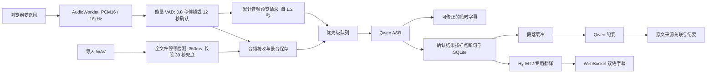

# 架构与课程实验

## 数据路径

演示模式跳过音频模型，用固定双语样本验证交互、存储与调度。真实模式的 ASR 使用 Qwen Transformers，翻译使用独立的 Hy-MT2 专用模型；纪要继续使用独立配置的 Qwen。CPU 翻译采用官方 Q4_K_M + llama.cpp，GPU 可选 Transformers 或独立兼容服务。

## 调度

只有一个线程执行推理任务，避免 CPU/GPU 上多个模型调用无控制争抢；ASR（含预览）优先级 0、翻译 1、纪要 2。队列不抢占已经执行的任务。Hy-MT2 翻译最多 768 新 token、纪要最多 384 新 token；一段纪要最多输入 8 句。参数可按质量与延迟实验调整。

每条音频只允许一个预览推理在执行，期间到达的预览合并为最新请求。确认时忽略过时预览，若最后一次识别覆盖的音频与最终片段完全一致则复用结果。最终 ASR 按接收顺序确认，翻译在确认之后独立排队，音频确认回执不再等待翻译完成。预览本身不写入字幕表，也不翻译或生成纪要。

会议结束会先标记 finishing，拒绝后续新输入，等待已接受任务完成，再为没有关联纪要的原文生成剩余纪要。异常不会被替换为演示答案。进程重启后，未完成会议标记 interrupted，已完成内容仍可查看、导出和手动整理。

## 存储

SQLite 中 meetings / segments / summaries 三张表分别存会议、带时间范围的原文及译文、带片段 ID 的段落纪要。录音单独保存为 WAV。数据库不开启在公网访问，不把 `.env`、录音和缓存提交到 Git。

目前只有会议中已有字幕的音频具有界面回放入口。识别失败或空结果的已接收 WAV 仍保留在 `DATA_DIR/audio/<meeting_id>/`，需从目录排查。浏览器尚未发送的缓冲不在持久化范围内。

导入文件保存到 `audio/<meeting_id>/imports/<import_id>/`：`source.wav` 是完整 16kHz 单声道标准化音频；`clip-*.wav` 是按停顿生成的模型输入；`manifest.json` 记录原文件时长、会议内偏移、每段实际样本范围与边界类型。长静音不送入 ASR，但完整来源保留，重复导入时使用原文件完整时长衔接时间轴。

## 建议实验

| 实验 | 固定条件 | 观察指标 |
|---|---|---|
| ASR 0.6B / 1.7B | 相同录音、设备、dtype、分片 | 中文 CER、英文 WER、识别耗时 |
| Qwen 0.6B / Hy-MT2 1.8B / Hy-MT2 7B | 相同原文、术语表，记录各模型推荐提示模板及量化方式 | 翻译忠实度、术语一致性、耗时 |
| 无术语 / 有术语 | 相同课程录音 | 专业术语识别与翻译错误 |
| 开启 / 关闭自动纪要 | 相同音频回放速率 | 字幕延迟、队列积压 |
| 串行到达顺序 / 优先级 | 相同模型与任务序列 | ASR 等待时间、翻译等待时间 |

当前页面的耗时字段不能直接代表端到端延迟；后续正式实验需要同时记录客户端音频片段结束时间、服务端接收、队列开始、模型完成、前端显示，并校准时钟或使用客户端单调计时。模型冷启动、首次下载和热推理应分别报告。

纪要用人工标注的关键点覆盖率与无依据内容数量评测，来源关联方便核查，但不保证模型每条结论都正确。

## 三人分工与 8 分钟汇报

- 模型与硬件：AMD 环境检查、Qwen 适配、模型规模与 dtype 对比。
- 系统：PCM 音频、VAD、WebSocket、优先级队列和数据持久化。
- 应用与评测：交互界面、数据准备、翻译／纪要人工评价及演示。

建议 1 分钟场景、2 分钟架构与硬件、2 分钟应用演示、2 分钟实验、1 分钟结论与局限。最终汇报使用实际测试结果，保留录屏应对平台资源不可用。
