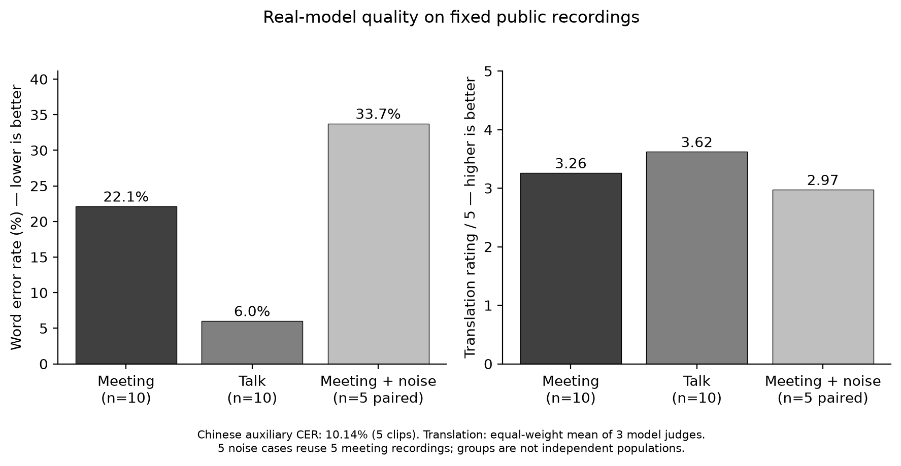
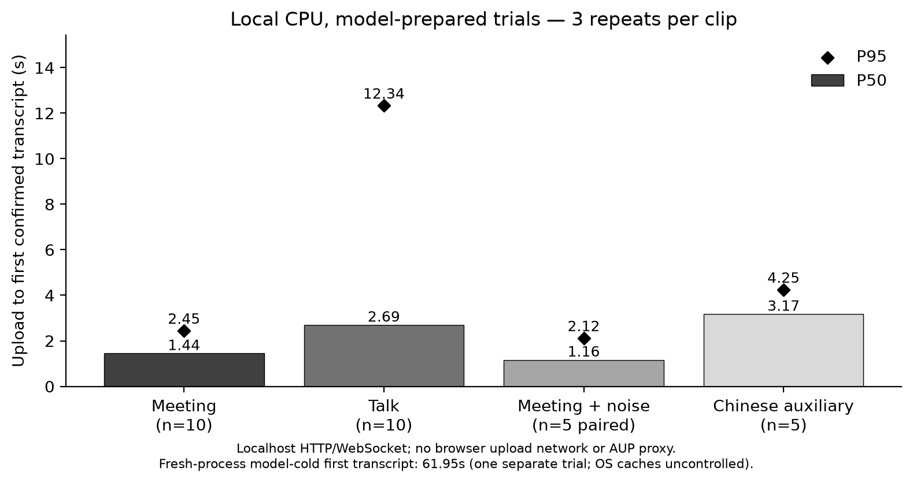
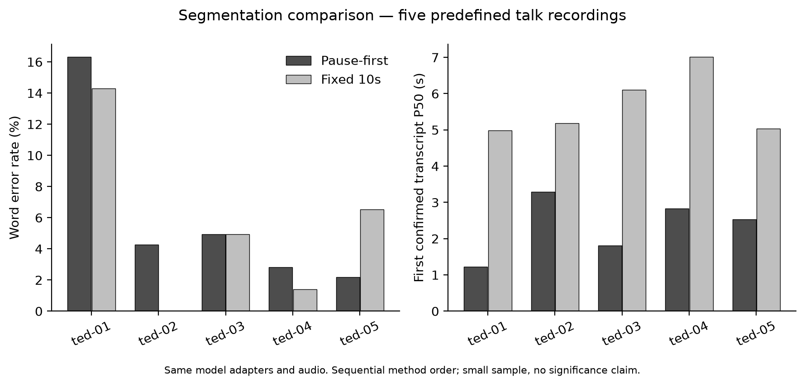

# 本地课程实验结果 · 2026-10-25

已完成真实模型实验：30个音频案例（25个原始片段＋5个配对加噪副本），主方案每条重复3次；另对5条预先固定的演讲音频进行固定10秒切分对照，每条3次。含两次单独冷请求，共107次文件处理。三个不同模型对子集中的25条英语→中文结果独立评分，共75条评审。

本地CPU实测，不能作为AMD-AUP的GPU数据。计时从服务器本机客户端开始HTTP上传，到WebSocket收到首条已确认字幕；不包括浏览器页面绘制、客户端到云端网络或实时麦克风采集。

## 环境与模型

- AMD Ryzen 5 7640HS，WSL2，CPU推理，6个计算线程。
- Python 3.11；PyTorch 2.14.1+cpu；Transformers 5.20.2。
- 识别：Qwen3-ASR-0.6B-hf，bfloat16；默认英语→中文会议，识别采用现有自动语种检测。
- 翻译：Hy-MT2-1.8B，Q4_K_M GGUF，llama.cpp CPU。
- 纪要：Qwen3-0.6B，bfloat16，抽取式；每4条已确认字幕触发，结束会议后整理余下字幕。
- 应用代码版本：`3c10d7085fba95740b005be1a2be6a8f511c5c94`。本次新增实验工具，未在实验中调整业务模型或音频策略。
- 执行时间：2026-10-25 18:49–19:13（北京时间）。同期有开发与测试进程，操作系统缓存未清空；属于课程原型实测，不是隔离硬件基准。

## 主结果

质量取第1次热态结果，错误率按参考词/字数累计。热态延迟取3次重复的观测分布；重复不增加独立样本数。

| 场景 | 案例数 | 转写错误率↓ | 翻译模型评审↑ | 首字幕P50 | 首字幕P95 | 完成含纪要P50 |
|---|---:|---:|---:|---:|---:|---:|
| AMI会议发言 | 10 | WER 22.10% | 3.26/5 | 1.44秒 | 2.45秒 | 7.45秒 |
| TED演讲 | 10 | WER 6.00% | 3.62/5 | 2.69秒 | 12.34秒 | 18.49秒 |
| 会议加噪对照 | 5 | WER 33.72% | 2.97/5 | 1.16秒 | 2.12秒 | 7.88秒 |
| 中文辅助样本 | 5 | CER 10.14% | 不翻译 | 3.17秒 | 4.25秒 | 5.45秒 |

20个原始英语片段合计WER为 **9.51%（79/831）**，三评委平均加权分为 **3.44/5**。整体平均不能替代上表的场景区分。加噪案例仅与其配对的5个原始案例比较：原音频WER 29.07%，加噪后33.72%，不把10条会议与5条加噪的组间差异直接解释为噪声效果。

90次主方案热态试验的首字幕P50为 **2.15秒**、P95为 **7.12秒**；最长观测14.24秒。首译P50为2.71秒（75次英语试验）；完整处理含纪要P50为8.41秒。执行异常或缺失结果为0次，语义与识别错误仍按质量指标记录。中文15次热态试验均跳过额外翻译。

当前方案第一次真实文件请求首字幕为 **61.95秒**、完成为90.75秒；仅1次模型冷请求，包含模型加载，操作系统缓存不受控。不能把预热后的延迟用来描述首次使用体验，也不能据此推断GPU延迟。

## 切分对照：响应更早，质量与总耗时存在取舍

同样5条演讲音频、同一识别和翻译适配器，分别用停顿切分和固定10秒切分：

| 指标 | 停顿切分 | 固定10秒 |
|---|---:|---:|
| 累计WER | 5.78%（17/294） | 5.10%（15/294） |
| 首字幕P50 | 2.54秒 | 5.18秒 |
| 完成含纪要P50 | 18.04秒 | 14.29秒 |
| 5个文件的模型音频片段总数 | 21 | 10 |

停顿切分在这5条音频上都更早返回首字幕；WER表现为1条改善、1条持平、3条变差。它没有稳定提高准确率，并增加了片段和推理调用。当前方案先测、固定方案后测，顺序和缓存可能影响耗时；该小样本结果不作统计显著性或普遍优越性结论。

## 独立翻译评审

| 评委 | 模型别名 | 推理强度 |
|---|---|---|
| A | gpt-6.1-sol | high |
| B | gpt-6-astra | high |
| C | gpt-6-sol | medium |

共同标准：忠实性60%、术语和关键概念20%、中文流畅性20%，每项0–5分。先计算每位评委的单条加权分，再等权平均三个评委。参考转写为语义依据，ASR结果只用于定位，因此ASR错误会反映在端到端翻译评分中。输入顺序分别打乱，评委不查看其他评委结果。

25条中有1条的评委加权分最大差达到1分。接口不公开精确模型快照、温度或采样seed，不能把这些设置写成已控制参数；不同GPT模型仍可能存在共同偏差。已导出5条待团队人工复核的案例，尚未经过真人评分。分数属于模型评审，不是人工准确率。

## 瓶颈与下一步

可供汇报的核心问题是 **短语音片段的识别错误会传导到翻译**。会议样本中出现自动语种误判，也有否定词漏识别：`ami-04` 参考内容的 `can't` 被识别为 `can`，译文随之将限制条件变成“可以”。三位评委均识别出这个方向错误，表明语言流畅不能保证语义正确。

建议下一步实验：对过短的确认片段保留更多相邻音频上下文，比较最小片段长度/停顿阈值对WER、翻译忠实性与首字幕P95的影响。明确英语场景也可另设语种锁定对照，保留当前自动识别模式用于中英混说。目标是减少短片段误识别，同时控制新增等待时间；本次没有声称这些改动已实现或已提升效果。

本地长演讲的P95明显高于中位数，冷启动也需要提前准备。性能优化可围绕识别推理、片段数量和模型常驻测量；当前单用户文件测试不能证明并发调度或实时麦克风表现。

## 复核材料与限制

- [实验方法与执行命令](EVALUATION.md)。
- [汇总机器可读数据](experiments/2026-10-25/metrics.json)、[107次试验CSV](experiments/2026-10-25/trials.csv)。
- 同目录提供上述图表的PNG和SVG。
- 完整原始日志、逐段识别/译文、三份评分及错误证据、盲化输入、人工复核清单，保存在项目本地 `artifacts/evaluation/local-cpu-20261026/`。原始录音与数据不进Git。
- 公开样本索引、来源版本和音频哈希固定在 `configs/evaluation-suite.json`；已在另一目录重新下载恢复，全部音频哈希及完整manifest一致。
- 指标从原始文本统一重算。初版采集器将部分中文片段正常跳过翻译误记为缺失，并过滤了英语识别中的非拉丁token；最终统计已按保存的原始segments修正，原始日志保留。
- 样本小、AMI为近讲单人通道、同会话可能相关、噪声为人工高斯噪声；中文是朗读辅助集，TED并非全为学术演讲。公开参考文本未逐条重新审听，模型训练数据重叠未知。纪要质量未单独评分。

数据来源与许可见[实验方法](EVALUATION.md#来源)：AMI、TED-LIUM legacy test、Google FLEURS。
